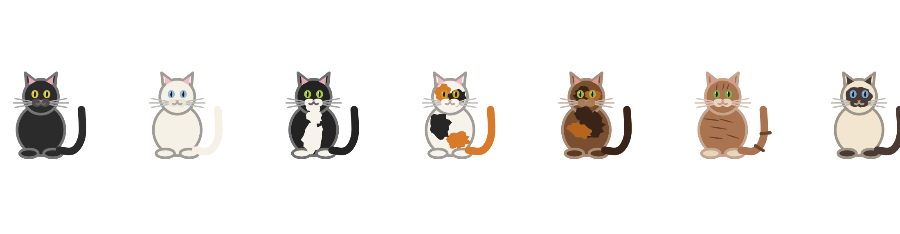

# geomfeliscatus

`geomfeliscatus` is a small, complete example of extending ggplot2 with a
new geom. It draws cats.

**Documentation:** <https://dar4datascience.github.io/geom_feliscatus/>

Cats come in seven coats: **black**, **white**, **tuxedo**, **calico**,
**tortoise**, **tabby** and **siamese**. They can sit, loaf, curl up or
stand; have six tail shapes; wear nine accessories; and come with mood
extras. The `coat`, `pose` and `tail` aesthetics are identity scales, so the
value you supply is the cat you get, whether you fix it in the layer or map
it from your data.

## Installation

```r
# install.packages("pak")
pak::pak("dar4datascience/geom_feliscatus")
```

## A first cat

```r
library(ggplot2)
library(geomfeliscatus)

ggplot(data.frame(x = 1, y = 1), aes(x, y)) +
  geom_cat(coat = "tuxedo", size = 30) +
  coord_equal() +
  theme_void()
```

## The seven coats

```r
cats <- data.frame(x = seq_along(cat_coats()), y = 1, coat = cat_coats())

ggplot(cats, aes(x, y, coat = coat)) +
  geom_cat(size = 22) +
  coord_equal() +
  theme_void()
```



| Coat | Description |
|:--|:--|
| `"black"` | Solid black fur with amber eyes. |
| `"white"` | Cream-white fur with blue eyes. |
| `"tuxedo"` | Black with a white bib, chin and paws. |
| `"calico"` | White with orange and black patches. |
| `"tortoise"` | Brown with dark and ginger mottling (also `"tortoiseshell"`). |
| `"tabby"` | Brown with dark stripes on the body, forehead and tail. |
| `"siamese"` | Cream with dark points on the face, ears, paws and tail. |

## Poses and tails

`pose` and `tail` are aesthetics, so one layer can mix them.

```r
poses <- data.frame(x = seq_along(cat_poses()), y = 1, pose = cat_poses())

ggplot(poses, aes(x, y, pose = pose)) +
  geom_cat(size = 24, tail = "curl") +
  scale_pose_discrete(labels = toupper) +
  coord_equal() +
  theme_void()
```

Poses are `sitting`, `loaf`, `curled` and `standing`; tails are `up`,
`curl`, `plume`, `kink`, `bob` and `none`.

## Accessories and moods

`accessory` and `mood` are layer parameters.

```r
ggplot(data.frame(x = 1, y = 1), aes(x, y)) +
  geom_cat(
    coat = "tabby",
    size = 30,
    accessory = "wizard_hat",
    mood = "sparkle"
  ) +
  coord_equal() +
  theme_void()
```

Accessories: `collar`, `bowtie`, `party_hat`, `wizard_hat`, `scarf`,
`glasses`, `headphones`, `crown`, `santa_hat`. Moods: `zzz`, `heart`,
`sparkle`, `anger`, `sweat`, `music`, `fish`, `yarn`, `pawprints`, `shadow`,
`box`.

## Aesthetics

`geom_cat()` understands `x`, `y`, `coat`, `pose`, `tail`, `size` (the
height of the cat in mm), `colour`, `fill`, `alpha`, `linewidth` and
`angle`. Layer parameters `eyes` (`"open"` or `"closed"`), `whiskers`,
`seed`, `accessory`, `mood` and `silhouette` control expression, markings
and decoration.

```r
ggplot(cats, aes(x, y, coat = coat)) +
  geom_cat(
    size = 20,
    angle = rep(c(0, 15, -20, 30), length.out = nrow(cats)),
    eyes = "closed"
  ) +
  scale_coat_discrete(labels = toupper) +
  coord_equal() +
  theme_void()
```

`silhouette = TRUE` draws the cat as one solid shape, with no face,
markings, whiskers or accessory.

```r
silhouettes <- data.frame(x = 1:2, y = 1)

ggplot(silhouettes, aes(x, y)) +
  geom_cat(data = silhouettes[1, ], coat = "calico", size = 30) +
  geom_cat(
    data = silhouettes[2, ],
    coat = "calico",
    size = 30,
    silhouette = TRUE
  ) +
  coord_equal() +
  theme_void()
```

## Learning to extend ggplot2

The package is written to be read. The
[vignette](vignettes/extending-ggplot2.Rmd) walks through the layer from
`ggproto()` to `draw_panel()`, the legend key, the user-facing function and
the custom scale.

The repository also ships a scaffold for your own geoms:

- `dev/preview.R` renders every coat to `dev/output/` for a quick visual
  check while you work.
- `inst/templates/geom-template.R` is a commented Geom + Stat + scale
  template.
- `dev/README.md` describes the edit, preview, test, document loop.

```r
usethis::use_template(
  "geom-template.R",
  save_as = "R/geom-mything.R",
  package = "geomfeliscatus"
)
```

## Website

The documentation site is a Quarto website in [`website/`](website/).
Render it locally with:

```sh
quarto render website
```

The rendered site lands in `website/_site/`. Pushes to `main` publish it to
GitHub Pages with
[`.github/workflows/publish.yml`](.github/workflows/publish.yml). In the
repository settings, set **Pages -> Build and deployment -> Source** to
**GitHub Actions** once.

The images on the site are generated by `dev/site-images.R`; re-run it after
changing the drawing code and commit the new files.

## Further reading

- [The documentation site](https://dar4datascience.github.io/geom_feliscatus/)
- [How geom_cat() works](vignettes/extending-ggplot2.Rmd), a guided tour of
  the code in this package.
- [ggplot2: extending ggplot2](https://ggplot2-book.org/ext-ggplot2.html).
- [Easy geom recipes](https://evamaerey.github.io/easy-geom-recipes/).
- The [ggplot2 extenders club](https://ggplot2-extenders.github.io/ggplot-extension-club/).
