Every image on this page was rendered with `geom_cat()`. The code under
each figure is the code that made it.

## The seven coats {#coats}

::: {layout-ncol=4}
[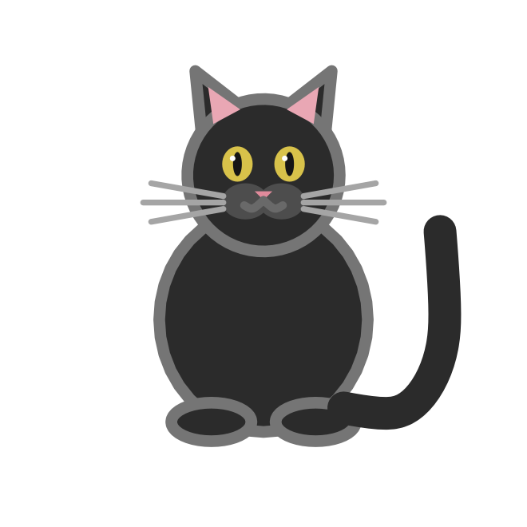{fig-alt="A black cat with amber eyes."}](#black)

[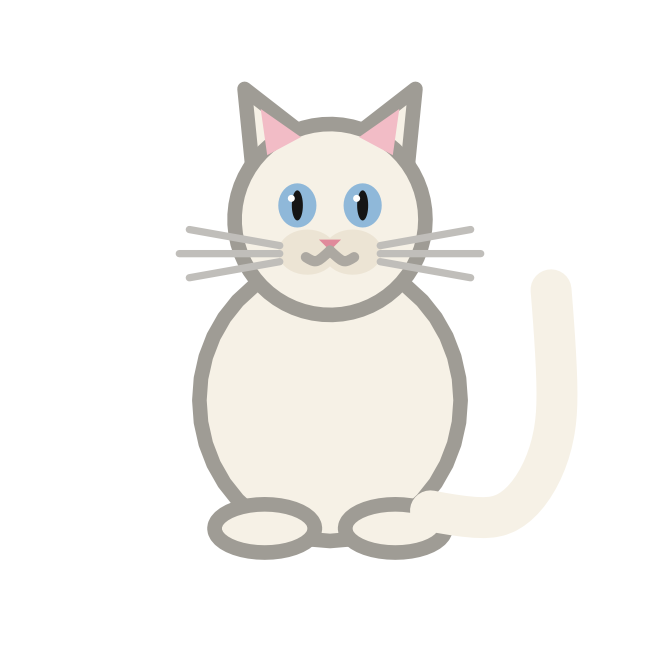{fig-alt="A cream-white cat with blue eyes."}](#white)

[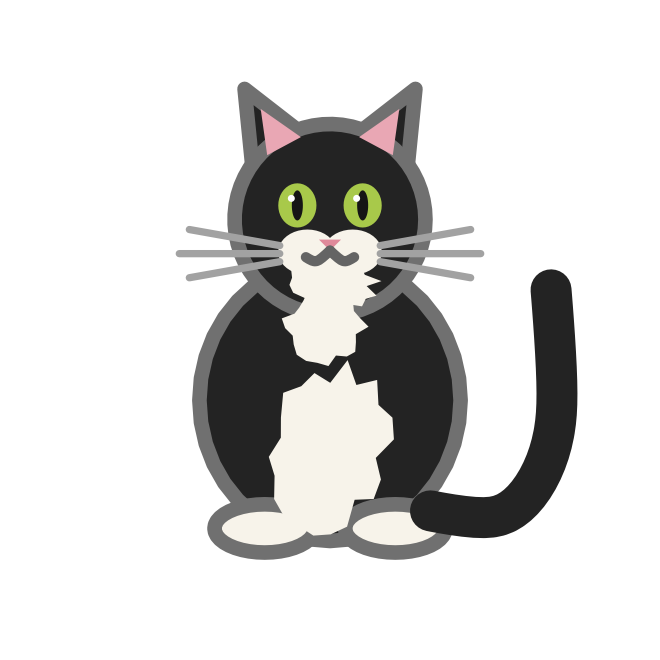{fig-alt="A black cat with a white bib, chin and paws."}](#tuxedo)

[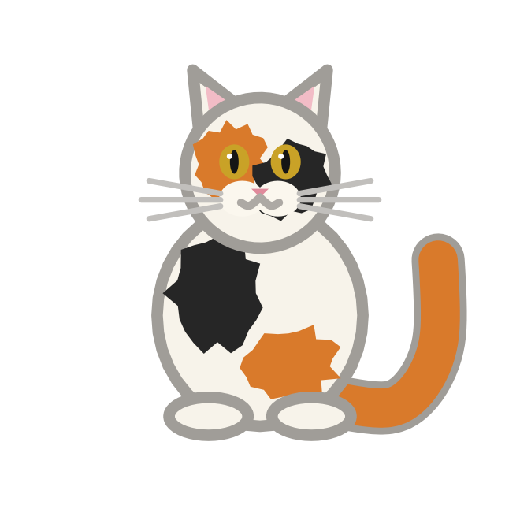{fig-alt="A white cat with orange and black patches."}](#calico)

[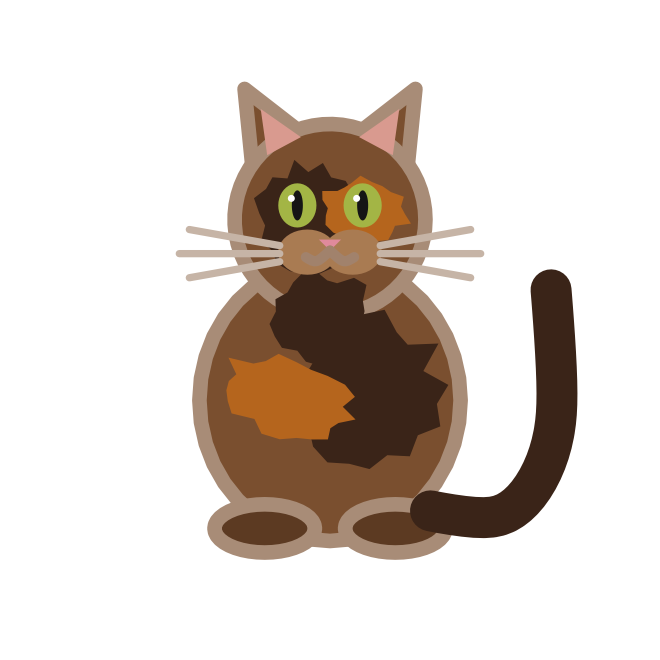{fig-alt="A brown cat with dark and ginger mottling."}](#tortoise)

[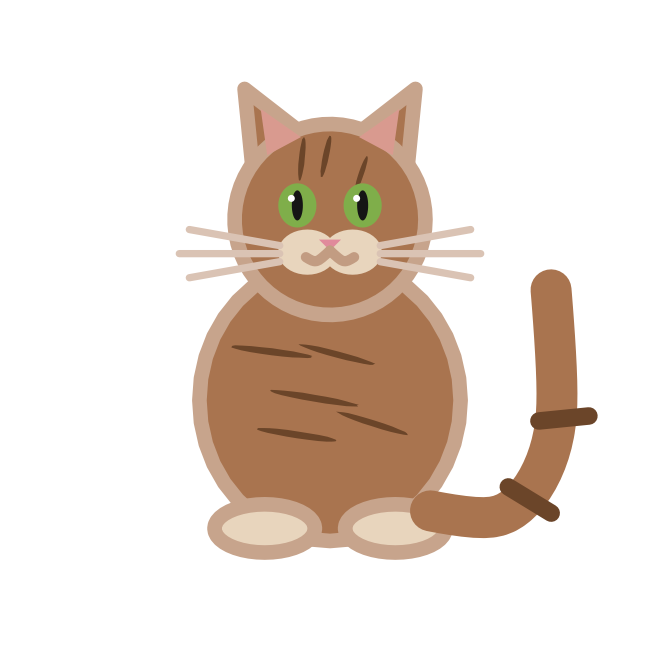{fig-alt="A brown tabby cat with dark stripes."}](#tabby)

[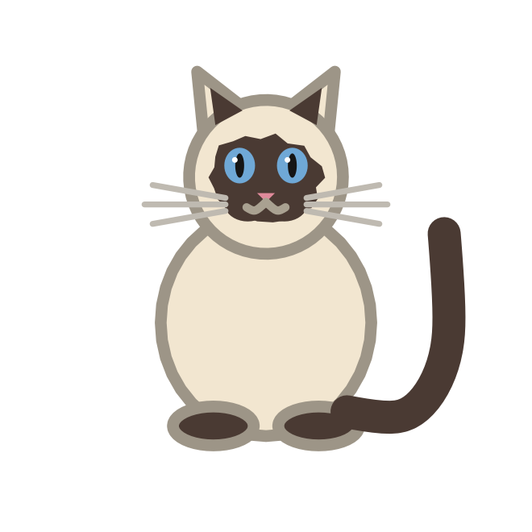{fig-alt="A cream cat with a dark face mask, ears, paws and tail."}](#siamese)
:::

### Black {#black}

Solid black fur, amber eyes and a light rim so the silhouette reads on dark
backgrounds.

```r
ggplot(data.frame(x = 1, y = 1), aes(x, y)) +
  geom_cat(coat = "black", size = 40)
```

### White {#white}

Cream-white fur, blue eyes and a grey rim.

```r
ggplot(data.frame(x = 1, y = 1), aes(x, y)) +
  geom_cat(coat = "white", size = 40)
```

### Tuxedo {#tuxedo}

Black with a white bib, chin and paws.

```r
ggplot(data.frame(x = 1, y = 1), aes(x, y)) +
  geom_cat(coat = "tuxedo", size = 40)
```

### Calico {#calico}

White with orange and black patches on the head, body and tail.

```r
ggplot(data.frame(x = 1, y = 1), aes(x, y)) +
  geom_cat(coat = "calico", size = 40)
```

### Tortoise {#tortoise}

Brown with dark and ginger mottling. `"tortoiseshell"` and `"tortie"` are
accepted as aliases.

```r
ggplot(data.frame(x = 1, y = 1), aes(x, y)) +
  geom_cat(coat = "tortoise", size = 40)
```

### Tabby {#tabby}

Brown with dark stripes on the body and forehead, and rings on the tail.
`"mackerel"` is accepted as an alias.

```r
ggplot(data.frame(x = 1, y = 1), aes(x, y)) +
  geom_cat(coat = "tabby", size = 40)
```

### Siamese {#siamese}

Cream with dark points on the face, ears, paws and tail. `"point"` and
`"colourpoint"` are accepted as aliases.

```r
ggplot(data.frame(x = 1, y = 1), aes(x, y)) +
  geom_cat(coat = "siamese", size = 40)
```

## Poses

`pose` is an aesthetic. The four bodies are `sitting`, `loaf`, `curled` and
`standing`.

```r
poses <- data.frame(x = seq_along(cat_poses()), y = 1, pose = cat_poses())

ggplot(poses, aes(x, y, pose = pose)) +
  geom_cat(size = 34, tail = "curl") +
  scale_pose_discrete(labels = toupper) +
  coord_equal() +
  theme_void()
```

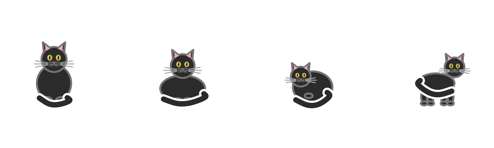{fig-alt="Four cats: sitting, in a loaf, curled up and standing."}

## Tails

`tail` is an aesthetic too. The six shapes are `up`, `curl`, `plume`,
`kink`, `bob` and `none`.

```r
tails <- data.frame(x = seq_along(cat_tails()), y = 1, tail = cat_tails())

ggplot(tails, aes(x, y, tail = tail)) +
  geom_cat(size = 34, coat = "tabby") +
  scale_tail_discrete(labels = toupper) +
  coord_equal() +
  theme_void()
```

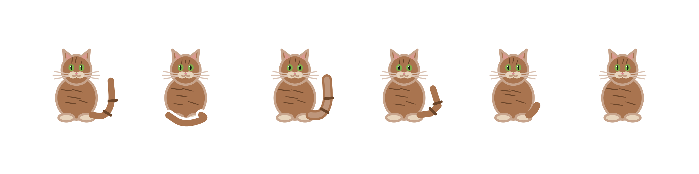{fig-alt="Six tabby cats with an upright tail, a curled tail, a plume, a kink, a bobtail and no tail."}

## Accessories

`accessory` is a layer parameter, so each accessory is its own layer.

```r
accessories <- setdiff(cat_accessories(), "none")
acc <- data.frame(x = seq_along(accessories), y = 1)

p <- ggplot(acc, aes(x, y)) + coord_equal() + theme_void()
for (i in seq_along(accessories)) {
  p <- p + geom_cat(
    data = acc[i, , drop = FALSE],
    size = 24,
    coat = "tabby",
    accessory = accessories[i]
  )
}
p
```

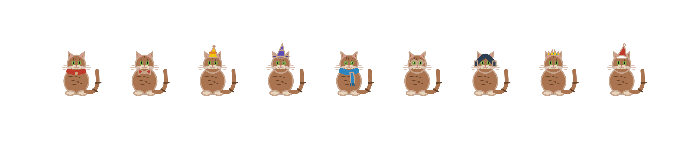{fig-alt="Nine tabby cats wearing a collar, bow tie, party hat, wizard hat, scarf, glasses, headphones, crown and Santa hat."}

## Moods

`mood` is a layer parameter as well.

```r
moods <- setdiff(cat_moods(), "none")
mood_data <- data.frame(x = seq_along(moods), y = 1)

p <- ggplot(mood_data, aes(x, y)) + coord_equal() + theme_void()
for (i in seq_along(moods)) {
  p <- p + geom_cat(
    data = mood_data[i, , drop = FALSE],
    size = 22,
    coat = "tuxedo",
    mood = moods[i]
  )
}
p
```

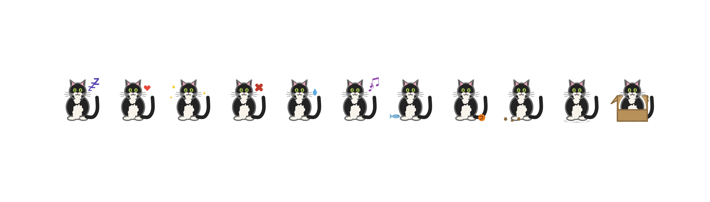{fig-alt="Cats with z's, a heart, sparkles, an anger mark, a sweat drop, music notes, a fish, yarn, paw prints, a shadow and a box."}

## Silhouettes

`silhouette = TRUE` drops the face, markings, whiskers and accessory and
draws the cat as one solid shape. Pale coats fall back to ink so they stay
visible.

```r
silhouettes <- data.frame(x = 1:2, y = 1)

ggplot(silhouettes, aes(x, y)) +
  geom_cat(data = silhouettes[1, , drop = FALSE], coat = "calico", size = 40) +
  geom_cat(
    data = silhouettes[2, , drop = FALSE],
    coat = "calico",
    size = 40,
    silhouette = TRUE
  ) +
  coord_equal() +
  theme_void()
```

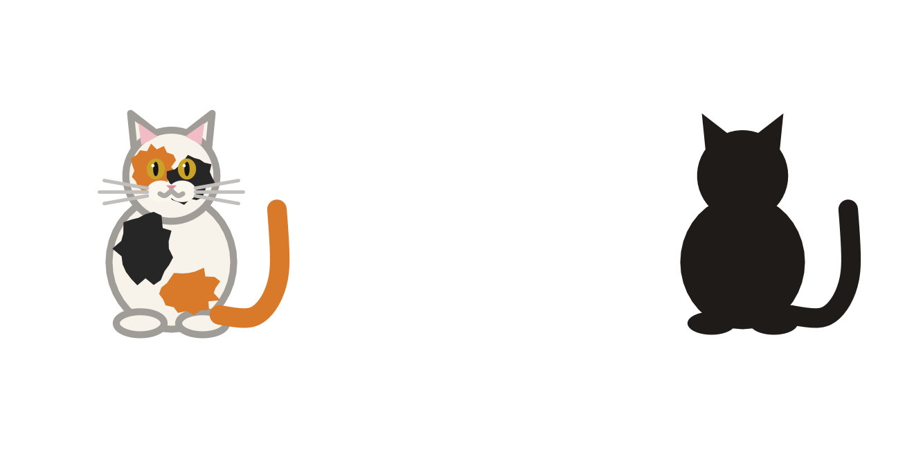{fig-alt="A calico cat beside the same cat drawn as a solid black silhouette."}

## Markings vary with the seed

Calico, tortoise and tabby markings are generated from a small deterministic
generator, so the same `seed` always gives the same cat and a different
`seed` gives a different pattern.

```r
seeds <- expand.grid(seed = 1:4, coat = c("calico", "tortoise", "tabby"))

ggplot(seeds, aes(seed, 1, coat = coat)) +
  facet_wrap(~coat, ncol = 1) +
  geom_cat(data = seeds[seeds$seed == 1, ], size = 38, seed = 1) +
  geom_cat(data = seeds[seeds$seed == 2, ], size = 38, seed = 2) +
  geom_cat(data = seeds[seeds$seed == 3, ], size = 38, seed = 3) +
  geom_cat(data = seeds[seeds$seed == 4, ], size = 38, seed = 4)
```

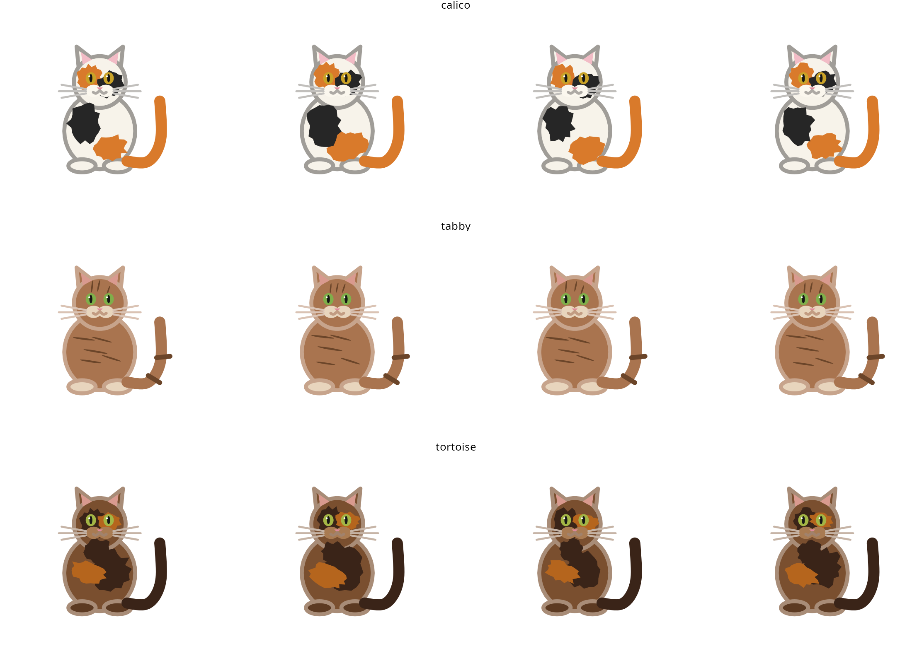{fig-alt="Three rows of cats. The first row shows four calico cats with different black and orange patch layouts; the second shows four tortoise cats with different mottling; the third shows four tabby cats with different stripe patterns."}

## Expression and rotation

`eyes` and `whiskers` are layer parameters; `angle` is an aesthetic.

```r
cats <- data.frame(x = 1:5, y = 1, coat = cat_coats()[1:5])

ggplot(cats, aes(x, y, coat = coat)) +
  geom_cat(
    size = c(26, 30, 26, 30, 26),
    angle = c(0, 15, -20, 30, 0),
    eyes = "closed",
    whiskers = FALSE
  )
```

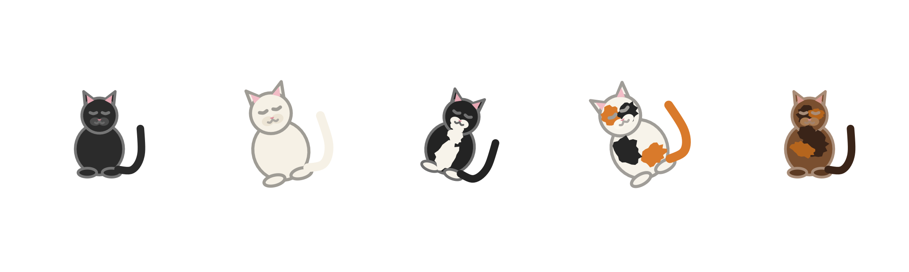{fig-alt="Five cats at different rotations, all with closed eyes and no whiskers."}

## Size

`size` is the height of the cat in millimetres.

```r
ggplot(data.frame(x = 1:5, y = 1), aes(x, y)) +
  geom_cat(coat = "tuxedo", size = c(8, 14, 20, 26, 32))
```

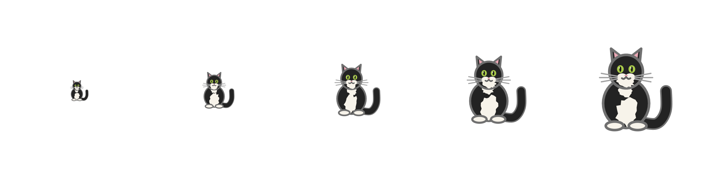{fig-alt="Five tuxedo cats of increasing size, from 8 mm to 32 mm tall."}

## Custom fur

`fill` replaces the base fur colour while keeping the coat's markings.
`colour` sets the outline.

```r
pastels <- data.frame(
  x = 1:3,
  y = 1,
  fur = c("#f6d5e0", "#d5e8f6", "#e6f6d5")
)

ggplot(pastels, aes(x, y)) +
  geom_cat(coat = "white", fill = pastels$fur, size = 40)
```

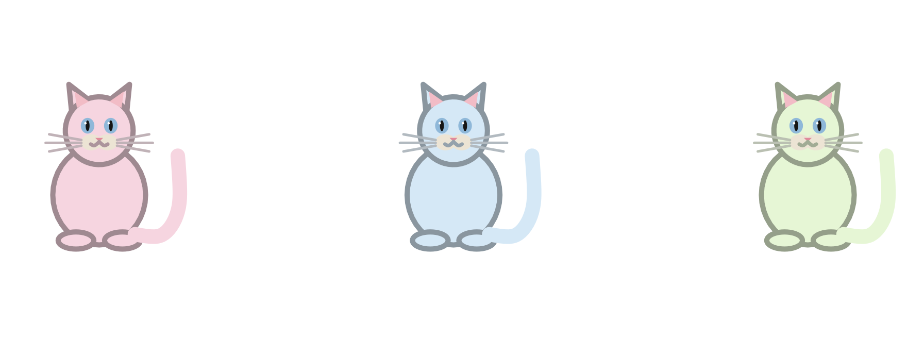{fig-alt="Three white cats with pink, light blue and light green fur."}

## Legends

The legend key is a small cat, drawn by `draw_key_cat()`.

```r
coats <- data.frame(
  x = seq_along(cat_coats()),
  y = 1,
  coat = cat_coats()
)

ggplot(coats, aes(x, y, coat = coat)) +
  geom_cat(size = 20)
```

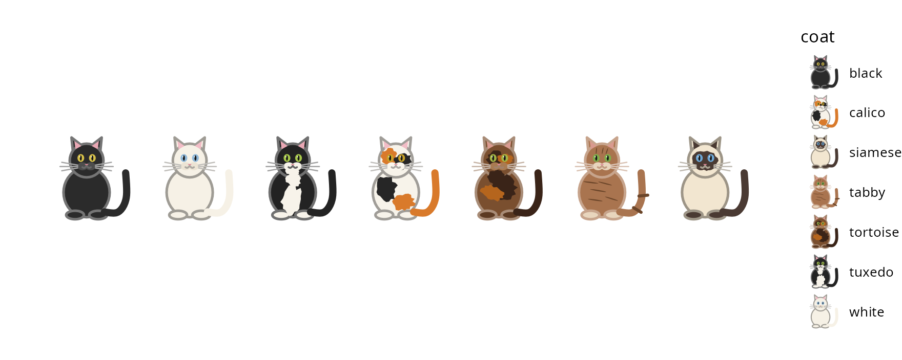{fig-alt="Seven cats in a row with a legend whose keys are miniature cats labelled black, calico, siamese, tabby, tortoise, tuxedo and white."}

Use `scale_coat_discrete()` to set a title or labels.

```r
ggplot(coats, aes(x, y, coat = coat)) +
  geom_cat(size = 20) +
  scale_coat_discrete(name = "Coat", labels = toupper)
```

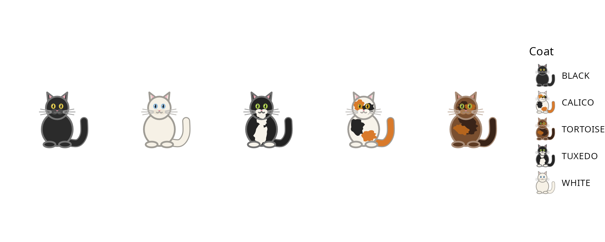{fig-alt="The same seven cats with a legend titled Coat and uppercase labels."}

## Cats in a plot

A cat is just a mark, so it composes with the rest of the grammar. Map
`size` when the cats themselves should carry a variable.

```r
cars <- transform(mtcars[1:10, ], coat = rep(cat_coats(), length.out = 10))

ggplot(cars, aes(wt, mpg, coat = coat, size = hp)) +
  geom_cat() +
  scale_size_area(max_size = 14) +
  theme_minimal()
```

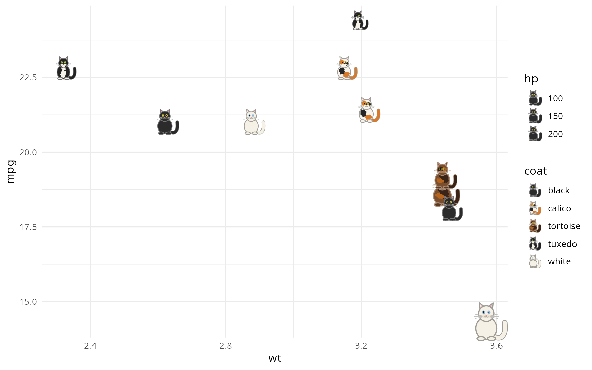{fig-alt="A scatterplot of ten cars where each point is a cat whose size grows with horsepower."}
