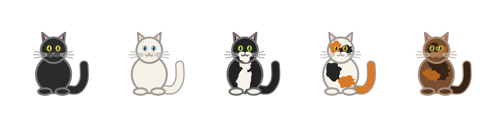
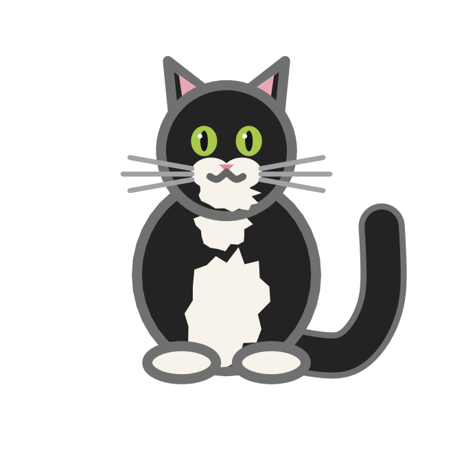
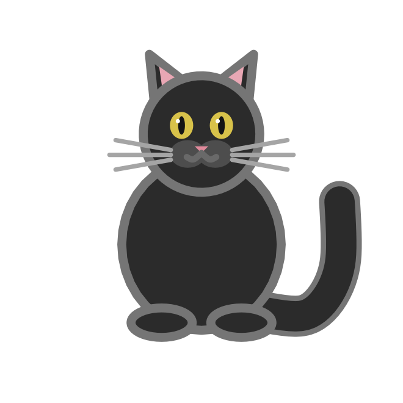
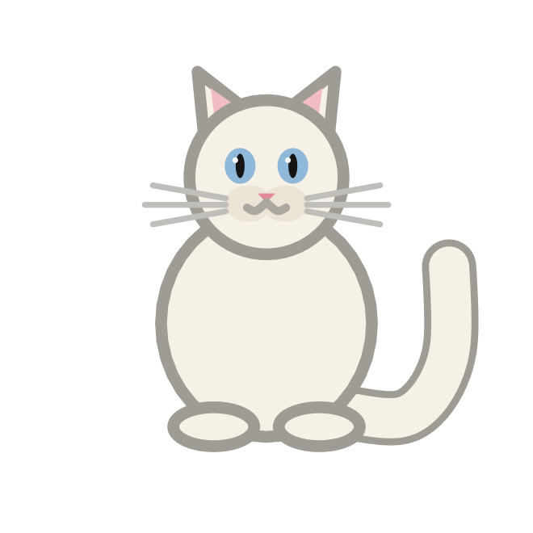
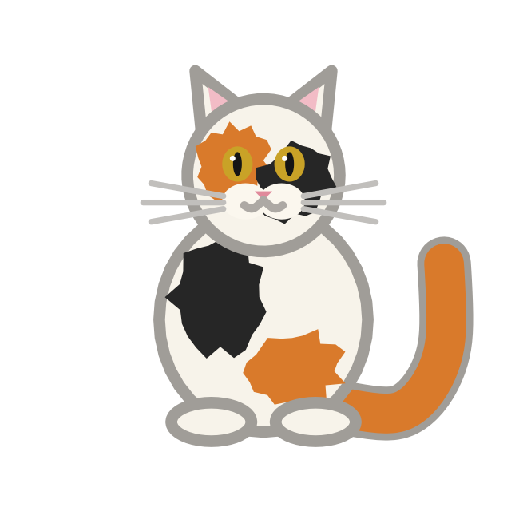
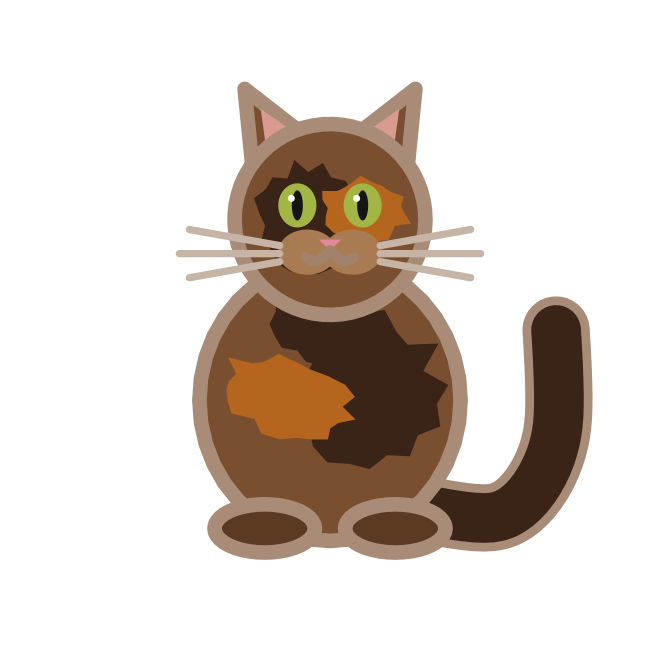

::: {.hero}
{fig-alt="Five cats in a row: black, white, tuxedo, calico and tortoise."}
:::

`geomfeliscatus` is a small, complete example of extending ggplot2 with a
new geom. It draws cats.

Cats come in five coats: **black**, **white**, **tuxedo**, **calico** and
**tortoise**. The `coat` aesthetic is an identity scale, so the value you
supply is the cat you get, whether you fix it in the layer or map it from
your data.

## Install

```r
# install.packages("pak")
pak::pak("dar4datascience/geom_feliscatus")
```

## A first cat

```r
library(ggplot2)
library(geomfeliscatus)

ggplot(data.frame(x = 1, y = 1), aes(x, y)) +
  geom_cat(coat = "tuxedo", size = 30) +
  coord_equal() +
  theme_void()
```

{width=220px fig-alt="A single tuxedo cat: black fur with a white bib, chin and paws."}

## The five coats

::: {layout-ncol=5}
[{fig-alt="A black cat with amber eyes."}](gallery.qmd#black)

[{fig-alt="A cream-white cat with blue eyes."}](gallery.qmd#white)

[{fig-alt="A black cat with a white bib, chin and paws."}](gallery.qmd#tuxedo)

[{fig-alt="A white cat with orange and black patches."}](gallery.qmd#calico)

[{fig-alt="A brown cat with dark and ginger mottling."}](gallery.qmd#tortoise)
:::

## What's inside

| Object | What it does |
|:--|:--|
| [`geom_cat()`](reference/geom-cat.qmd) | Draws a cat at each observation. |
| [`cat_coats()`](reference/cat-coats.qmd) | Lists the five coats. |
| [`scale_coat_discrete()`](reference/scale-coat.qmd) | Identity scale for the `coat` aesthetic. |
| [`GeomCat`](reference/geom-cat.qmd#the-ggproto-object) | The ggproto object behind the geom, exported for reuse. |

## Aesthetics at a glance

| Aesthetic | Default | Meaning |
|:--|:--|:--|
| `x`, `y` | required | Position of the cat. |
| `coat` | `"black"` | One of the five coats. |
| `size` | `8` | Height of the cat in mm. |
| `colour` | `NA` | Outline colour; `NA` picks a contrasting rim. |
| `fill` | `NA` | Overrides the base fur colour. |
| `alpha` | `NA` | Opacity. |
| `linewidth` | `1` | Outline width multiplier. |
| `angle` | `0` | Rotation in degrees. |

Layer parameters `eyes` (`"open"` or `"closed"`), `whiskers` and `seed`
control expression and the markings of calico and tortoise cats.

## Learn how it works

The package is written to be read. The
[extending guide](extending.qmd) walks through the layer from `ggproto()`
to `draw_panel()`, the legend key, the user-facing function and the custom
scale. The repository also ships a template for your own geoms in
`inst/templates/geom-template.R`.

::: {.callout-note}
## The coat scale is an identity scale

`coat = "calico"` is not a colour from a palette: it selects a drawing
recipe. That is why mapping `coat` in `aes()` needs no manual scale, and
why `scale_coat_discrete()` passes values through unchanged.
:::

## Further reading

- [ggplot2: extending ggplot2](https://ggplot2-book.org/ext-ggplot2.html)
- [Easy geom recipes](https://evamaerey.github.io/easy-geom-recipes/)
- The [ggplot2 extenders club](https://ggplot2-extenders.github.io/ggplot-extension-club/)
- The package [vignettes](https://github.com/dar4datascience/geom_feliscatus/tree/main/vignettes)
