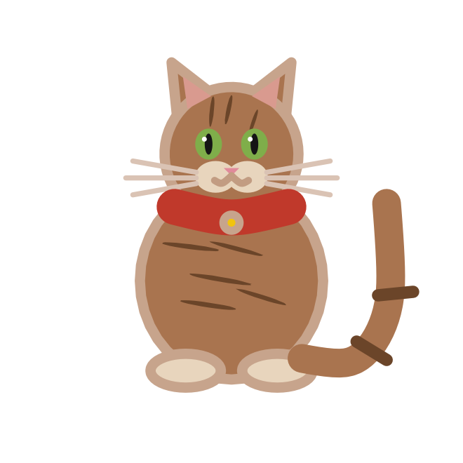
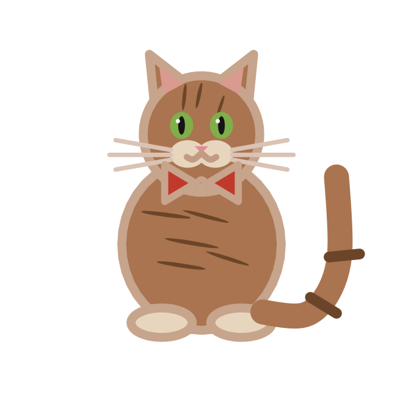
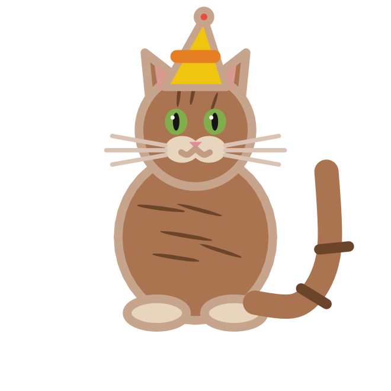
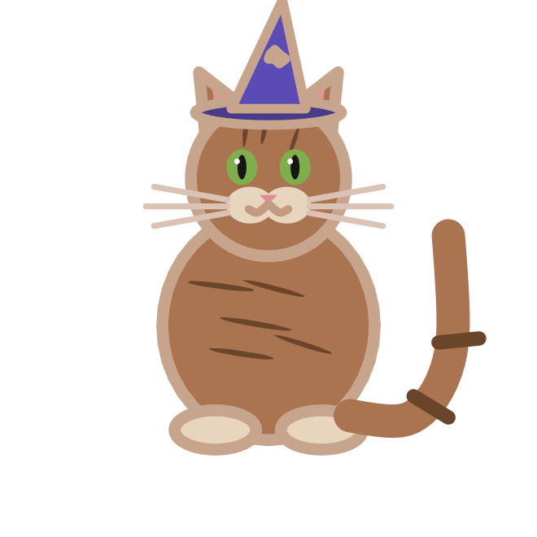
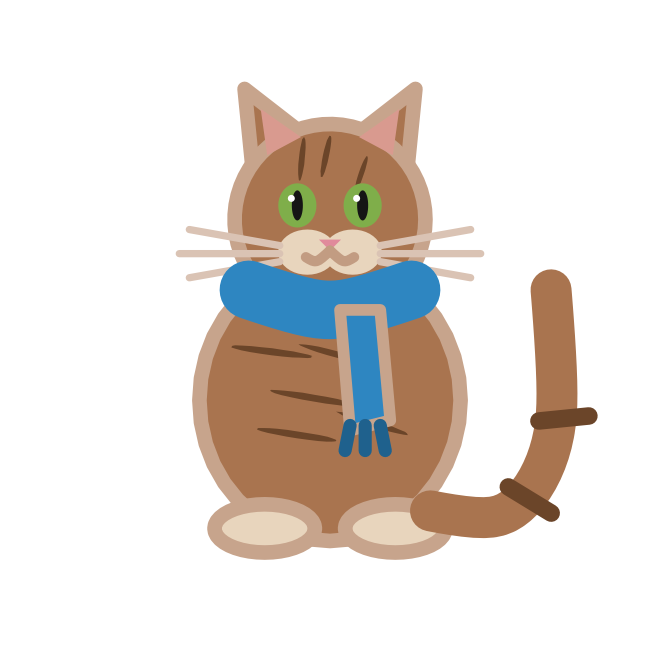
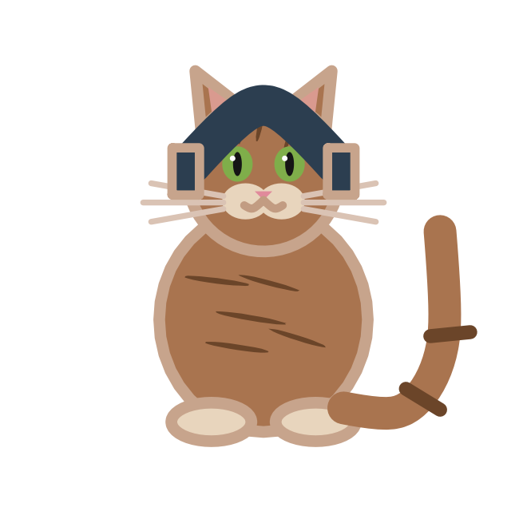
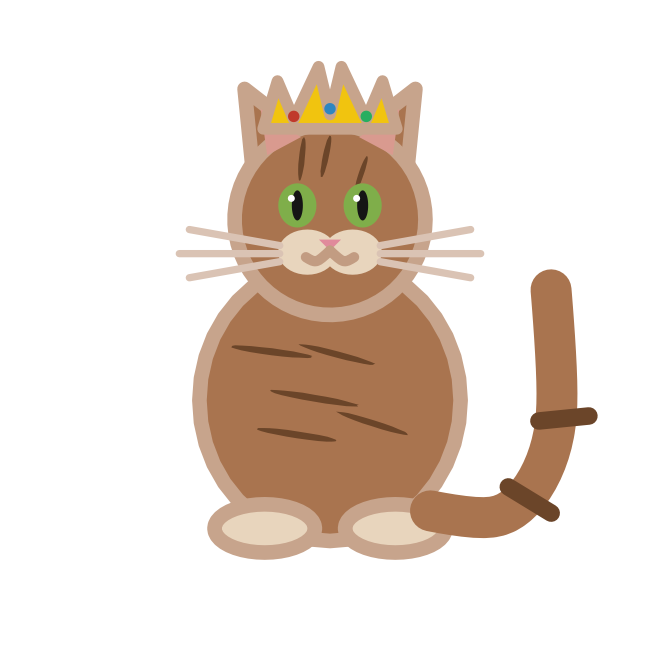
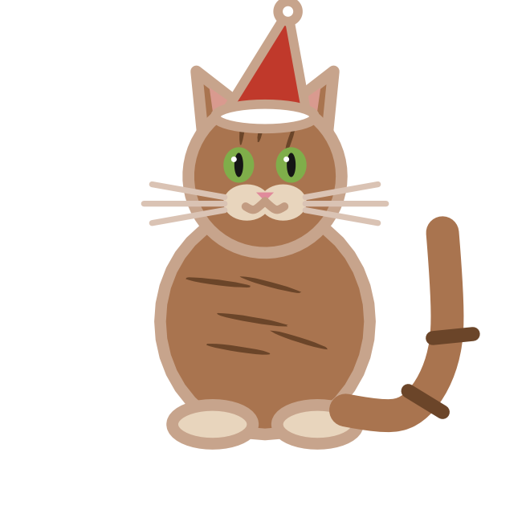

## Description

`cat_accessories()` lists the accessories that [`geom_cat()`](geom-cat.qmd)
can draw. Accessories are a layer parameter, not an aesthetic: one value
applies to the whole layer.

## Usage

```r
cat_accessories()
```

## Value

A character vector of accessory names:

```r
cat_accessories()
#>  [1] "none"       "collar"     "bowtie"     "party_hat"  "wizard_hat"
#>  [6] "scarf"      "glasses"    "headphones" "crown"      "santa_hat"
```

## The accessories

| Accessory | Look |
|:--|:--|
| `"none"` | No accessory. |
| `"collar"` | A red collar with a gold bell. |
| `"bowtie"` | A red bow tie at the neck. |
| `"party_hat"` | A yellow cone with a red pompom. |
| `"wizard_hat"` | A purple pointed hat with a star. |
| `"scarf"` | A blue scarf with a hanging end. |
| `"glasses"` | Round spectacles over the eyes. |
| `"headphones"` | A headband with ear cups. |
| `"crown"` | A gold crown with three jewels. |
| `"santa_hat"` | A red hat with a white brim and pompom. |

::: {layout-ncol=5}
{fig-alt="A tabby cat wearing a red collar with a gold bell."}

{fig-alt="A tabby cat wearing a red bow tie."}

{fig-alt="A tabby cat wearing a yellow party hat with a red pompom."}

{fig-alt="A tabby cat wearing a purple wizard hat with a star."}

{fig-alt="A tabby cat wearing a blue scarf."}

{fig-alt="A tabby cat wearing round glasses."}

{fig-alt="A tabby cat wearing headphones."}

{fig-alt="A tabby cat wearing a gold crown."}

{fig-alt="A tabby cat wearing a Santa hat."}
:::

## Examples

```r
ggplot(data.frame(x = 1, y = 1), aes(x, y)) +
  geom_cat(
    coat = "tabby",
    size = 40,
    accessory = "wizard_hat"
  ) +
  coord_equal() +
  theme_void()
```

```r
# One accessory per layer
hats <- data.frame(
  x = seq_along(cat_accessories())[-1],
  y = 1,
  accessory = cat_accessories()[-1]
)

p <- ggplot(hats, aes(x, y)) + coord_equal() + theme_void()
for (i in seq_len(nrow(hats))) {
  p <- p + geom_cat(
    data = hats[i, , drop = FALSE],
    size = 22,
    coat = "tabby",
    accessory = hats$accessory[i]
  )
}
p
```
