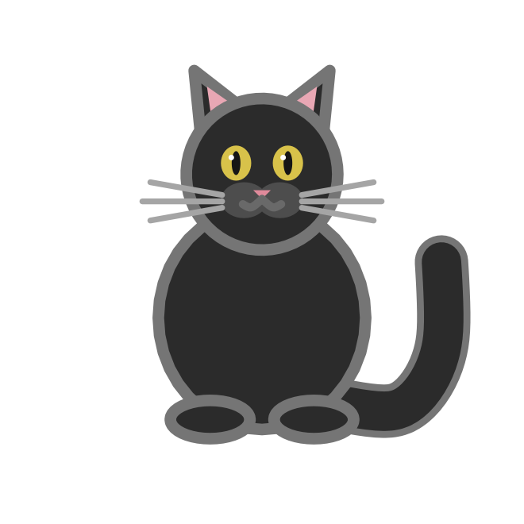
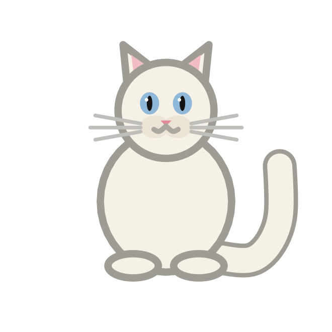
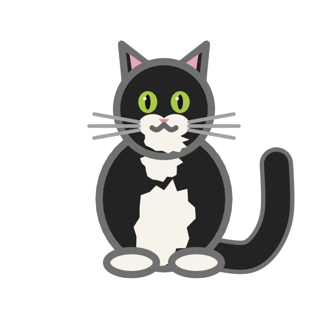
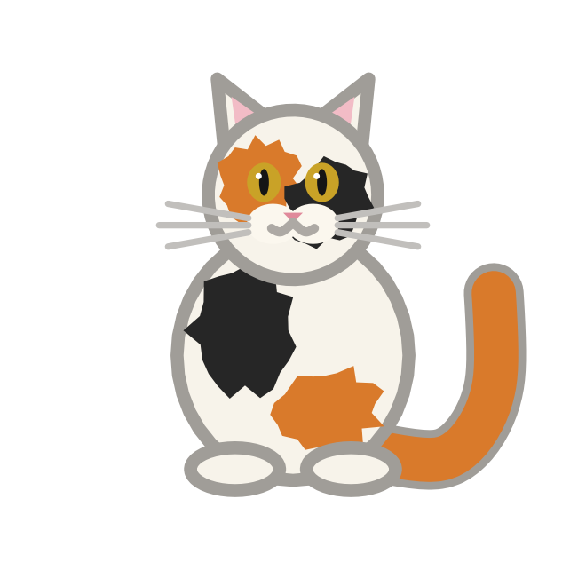
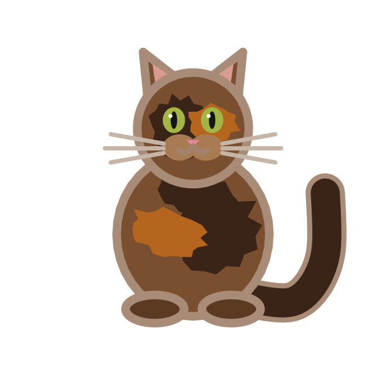

## Description

`cat_coats()` lists the coats that [`geom_cat()`](geom-cat.qmd) knows how
to draw. The names are also the values the `coat` aesthetic accepts,
which makes the coat scale an identity scale: the value you supply is the
coat you get.

## Usage

```r
cat_coats()
```

## Value

A character vector of coat names:

```r
cat_coats()
#> [1] "black"     "white"     "tuxedo"    "calico"    "tortoise"
```

## The coats

| Coat | Look |
|:--|:--|
| `"black"` | Solid black fur, amber eyes, a light rim. |
| `"white"` | Cream-white fur, blue eyes, a grey rim. |
| `"tuxedo"` | Black with a white bib, chin and paws. |
| `"calico"` | White with orange and black patches on the head, body and tail. |
| `"tortoise"` | Brown with dark and ginger mottling. |

::: {layout-ncol=5}
{fig-alt="A black cat with amber eyes."}

{fig-alt="A cream-white cat with blue eyes."}

{fig-alt="A black cat with a white bib, chin and paws."}

{fig-alt="A white cat with orange and black patches."}

{fig-alt="A brown cat with dark and ginger mottling."}
:::

## Aliases

Coat names are matched case-insensitively and with surrounding whitespace
removed. Two aliases are accepted:

| Alias | Coat |
|:--|:--|
| `"tortoiseshell"` | `"tortoise"` |
| `"tortie"` | `"tortoise"` |

Unknown coats raise an error that lists the supported values.

## Examples

```r
# All five coats in one plot
cats <- data.frame(
  x = seq_along(cat_coats()),
  y = 1,
  coat = cat_coats()
)

ggplot(cats, aes(x, y, coat = coat)) +
  geom_cat(size = 22) +
  coord_equal() +
  theme_void()
```

```r
# A coat can also be fixed in the layer
ggplot(data.frame(x = 1, y = 1), aes(x, y)) +
  geom_cat(coat = "calico", size = 40)
```
