## Description

`cat_moods()` lists the small extras that [`geom_cat()`](geom-cat.qmd) can
add around a cat. Moods are a layer parameter, not an aesthetic: one value
applies to the whole layer.

## Usage

```r
cat_moods()
```

## Value

A character vector of mood names:

```r
cat_moods()
#>  [1] "none"      "zzz"       "heart"     "sparkle"   "anger"
#>  [6] "sweat"     "music"     "fish"      "yarn"      "pawprints"
#> [11] "shadow"    "box"
```

## The moods

| Mood | Look |
|:--|:--|
| `"none"` | Nothing extra. |
| `"zzz"` | Three floating z's. |
| `"heart"` | A red heart. |
| `"sparkle"` | Three yellow sparkles. |
| `"anger"` | A red anger mark. |
| `"sweat"` | A blue sweat drop. |
| `"music"` | Two music notes. |
| `"fish"` | A small fish. |
| `"yarn"` | A ball of yarn. |
| `"pawprints"` | Three paw prints on the ground. |
| `"shadow"` | A soft shadow under the cat. |
| `"box"` | A cardboard box to sit in. |

::: {layout-ncol=4}
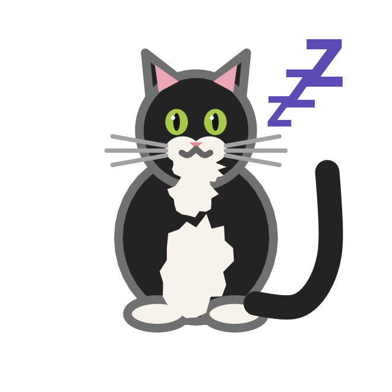{fig-alt="A tuxedo cat with three floating z's."}

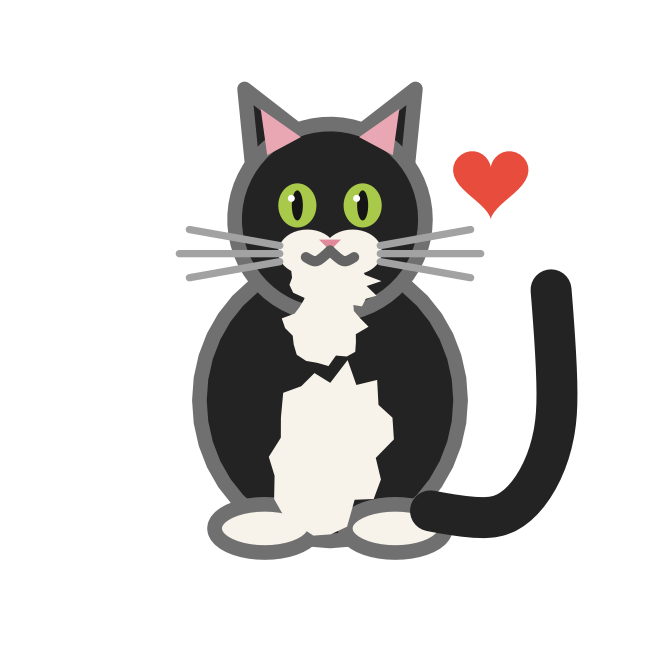{fig-alt="A tuxedo cat with a red heart."}

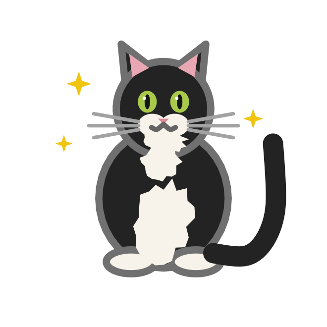{fig-alt="A tuxedo cat with yellow sparkles."}

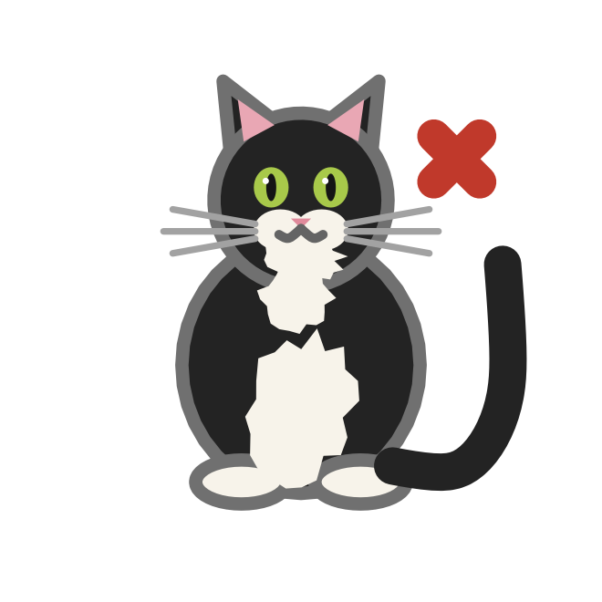{fig-alt="A tuxedo cat with a red anger mark."}

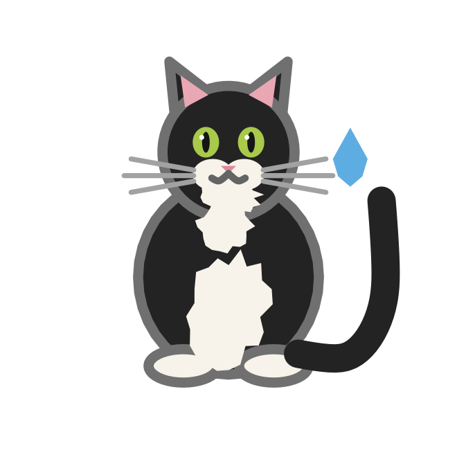{fig-alt="A tuxedo cat with a blue sweat drop."}

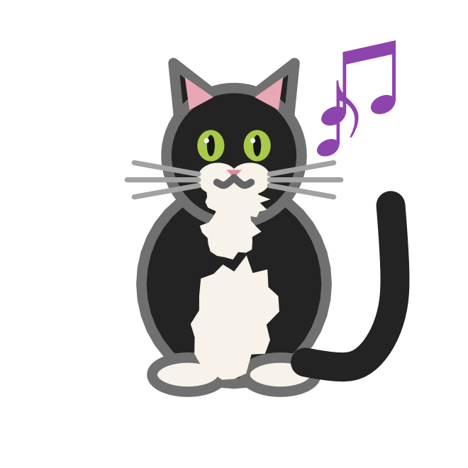{fig-alt="A tuxedo cat with music notes."}

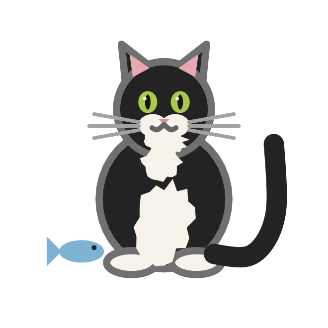{fig-alt="A tuxedo cat beside a small fish."}

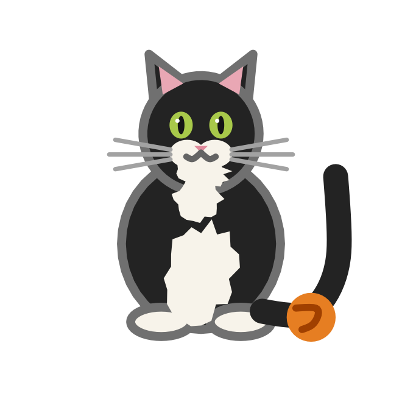{fig-alt="A tuxedo cat beside a ball of yarn."}

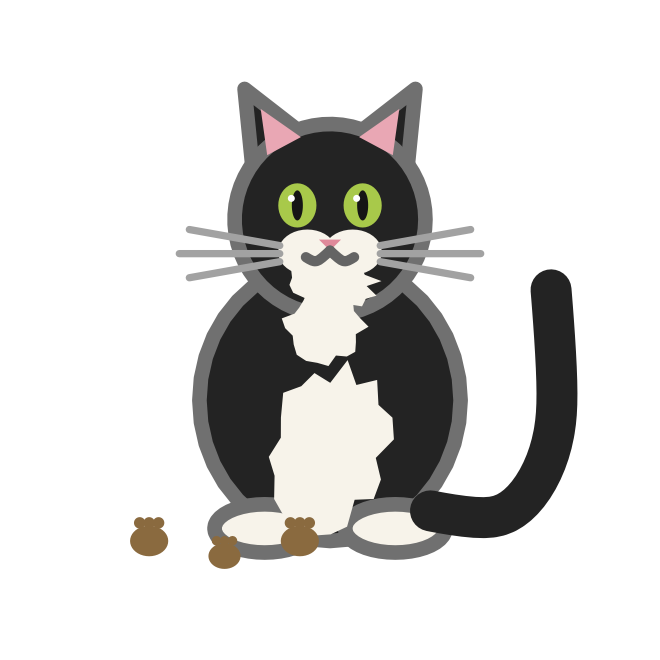{fig-alt="A tuxedo cat with paw prints on the ground."}

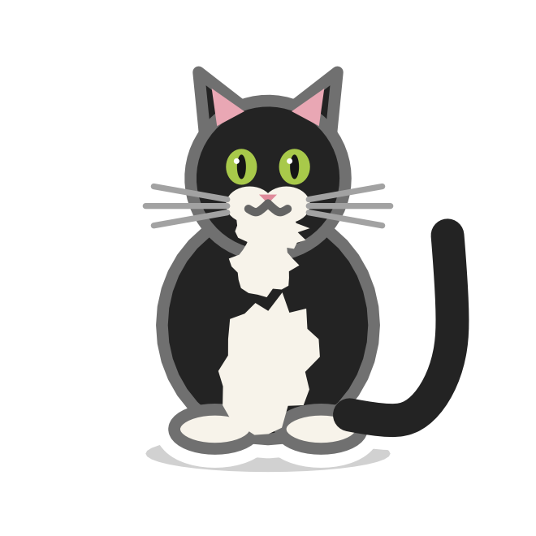{fig-alt="A tuxedo cat with a soft shadow."}

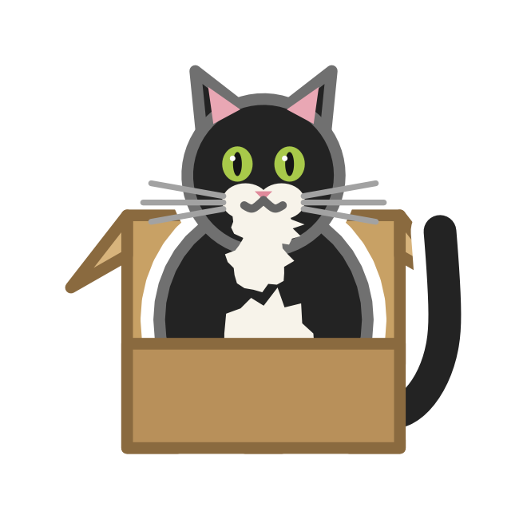{fig-alt="A tuxedo cat sitting in a cardboard box."}
:::

## Examples

```r
ggplot(data.frame(x = 1, y = 1), aes(x, y)) +
  geom_cat(
    coat = "tuxedo",
    size = 40,
    mood = "box"
  ) +
  coord_equal() +
  theme_void()
```

```r
# One mood per layer
moods <- data.frame(x = seq_along(cat_moods())[-1], y = 1)

p <- ggplot(moods, aes(x, y)) + coord_equal() + theme_void()
for (i in seq_along(cat_moods()[-1])) {
  p <- p + geom_cat(
    data = moods[i, , drop = FALSE],
    size = 20,
    coat = "tuxedo",
    mood = cat_moods()[-1][i]
  )
}
p
```
