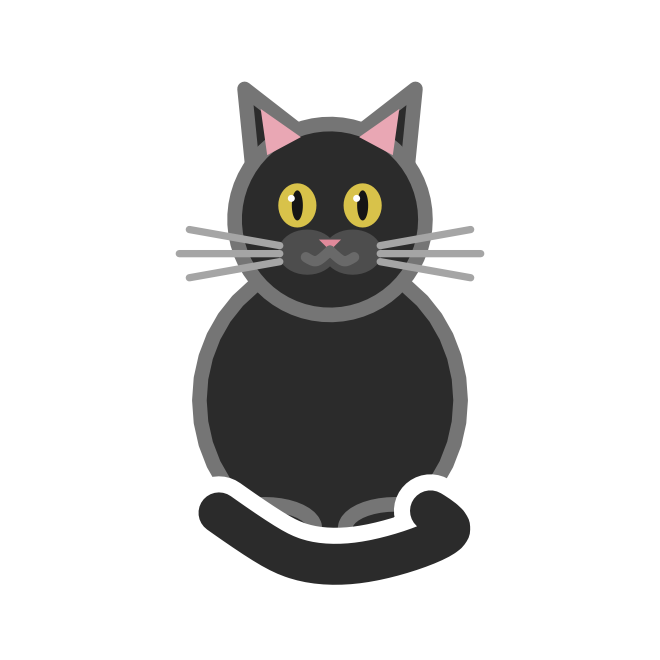
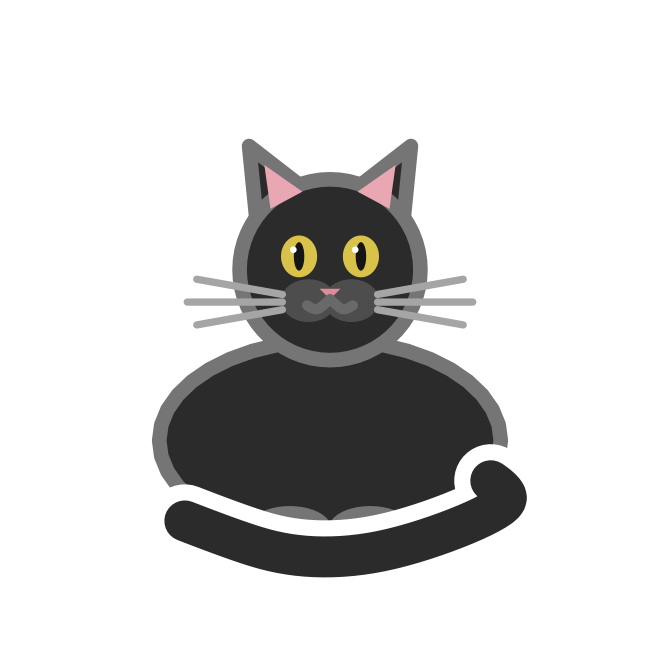
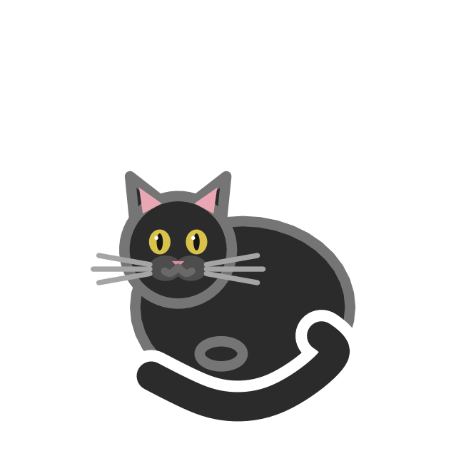
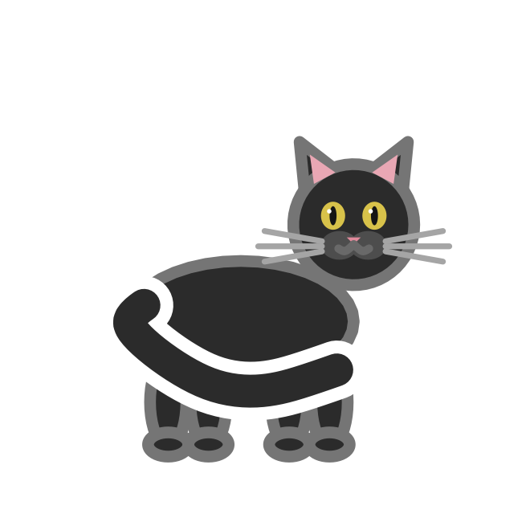

## Description

`cat_poses()` lists the body shapes that [`geom_cat()`](geom-cat.qmd) knows
how to draw. The names are also the values the `pose` aesthetic accepts,
which makes the pose scale an identity scale.

## Usage

```r
cat_poses()
```

## Value

A character vector of pose names:

```r
cat_poses()
#> [1] "sitting"  "loaf"     "curled"   "standing"
```

## The poses

| Pose | Look |
|:--|:--|
| `"sitting"` | Upright body, front paws together, head high. |
| `"loaf"` | Body low and wide, paws tucked under the chest. |
| `"curled"` | Rounded body with the head tucked to one side. |
| `"standing"` | Side-on body on four legs, head at the front. |

::: {layout-ncol=4}
{fig-alt="A sitting tuxedo cat."}

{fig-alt="A tuxedo cat in a loaf, with its paws tucked under its chest."}

{fig-alt="A tuxedo cat curled up with its head tucked to one side."}

{fig-alt="A tuxedo cat standing on four legs, seen from the side."}
:::

## Aliases

Pose names are matched case-insensitively and with surrounding whitespace
removed. These aliases are accepted:

| Alias | Pose |
|:--|:--|
| `"sit"` | `"sitting"` |
| `"loafing"` | `"loaf"` |
| `"sleep"`, `"sleeping"`, `"curled_up"` | `"curled"` |
| `"stand"` | `"standing"` |

Unknown poses raise an error that lists the supported values.

## Examples

```r
poses <- data.frame(x = seq_along(cat_poses()), y = 1, pose = cat_poses())

ggplot(poses, aes(x, y, pose = pose)) +
  geom_cat(size = 24, tail = "curl") +
  scale_pose_discrete(labels = toupper) +
  coord_equal() +
  theme_void()
```

```r
# A pose can also be fixed in the layer
ggplot(data.frame(x = 1, y = 1), aes(x, y)) +
  geom_cat(pose = "loaf", size = 40)
```
