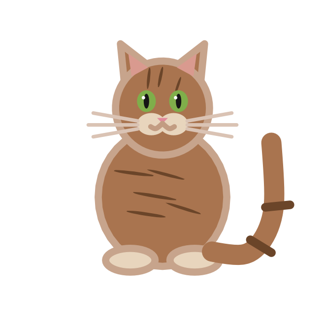
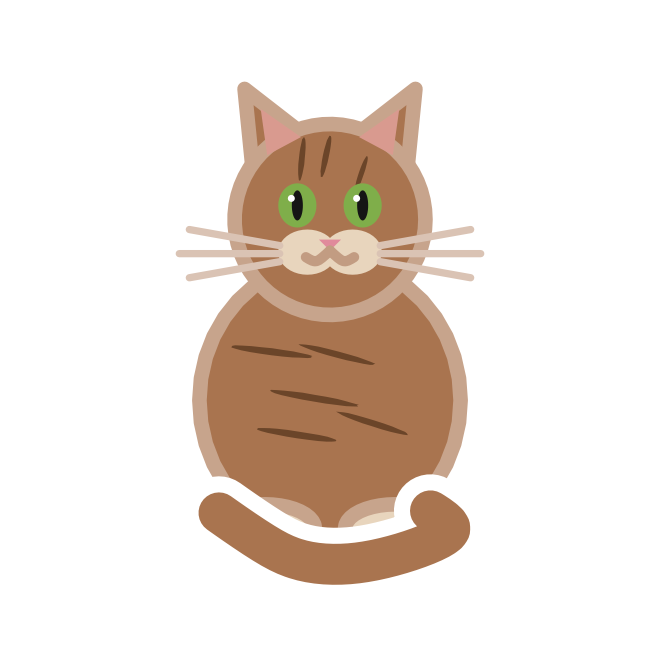
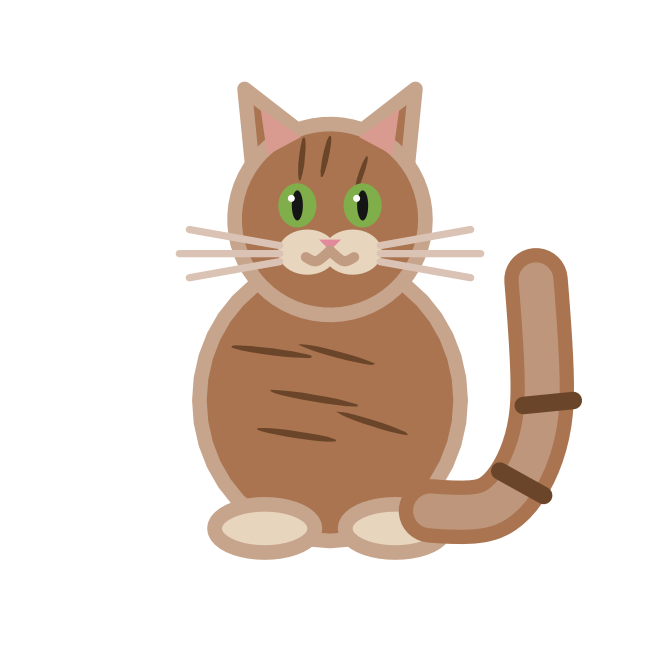
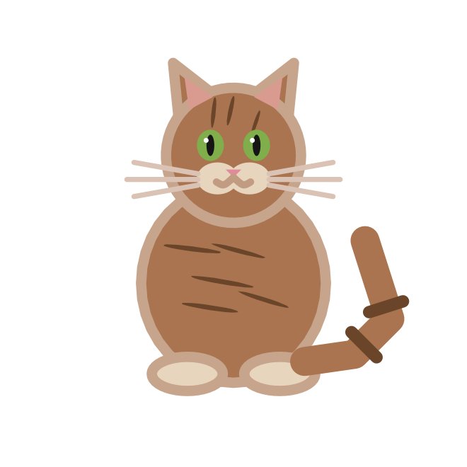
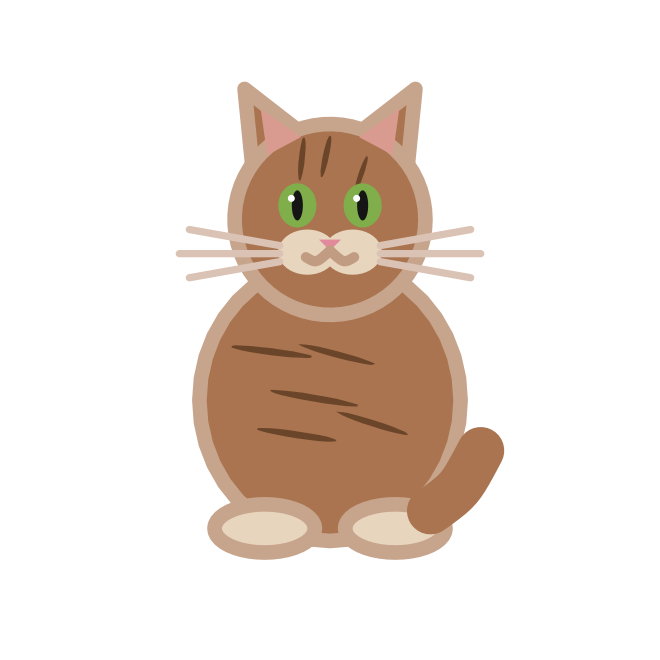
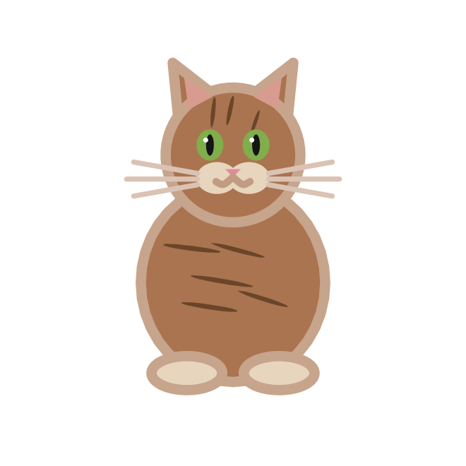

## Description

`cat_tails()` lists the tail shapes that [`geom_cat()`](geom-cat.qmd) knows
how to draw. The names are also the values the `tail` aesthetic accepts,
which makes the tail scale an identity scale.

## Usage

```r
cat_tails()
```

## Value

A character vector of tail names:

```r
cat_tails()
#> [1] "up"    "curl"  "plume" "kink"  "bob"   "none"
```

## The tails

| Tail | Look |
|:--|:--|
| `"up"` | Upright question-mark tail. |
| `"curl"` | Wraps around the body and in front of the paws. |
| `"plume"` | Thick bottlebrush tail. |
| `"kink"` | Upright tail with a sharp bend. |
| `"bob"` | Short stub. |
| `"none"` | Tailless, as on a Manx. |

::: {layout-ncol=6}
{fig-alt="A tabby cat with an upright tail."}

{fig-alt="A tabby cat whose tail curls around its body."}

{fig-alt="A tabby cat with a thick bottlebrush tail."}

{fig-alt="A tabby cat with a kinked upright tail."}

{fig-alt="A tabby cat with a short stub tail."}

{fig-alt="A tailless tabby cat."}
:::

## Aliases

Tail names are matched case-insensitively and with surrounding whitespace
removed. These aliases are accepted:

| Alias | Tail |
|:--|:--|
| `"straight"` | `"up"` |
| `"wrapped"` | `"curl"` |
| `"fluffy"` | `"plume"` |
| `"stub"` | `"bob"` |
| `"manx"`, `"tailless"` | `"none"` |

Unknown tails raise an error that lists the supported values.

## Examples

```r
tails <- data.frame(x = seq_along(cat_tails()), y = 1, tail = cat_tails())

ggplot(tails, aes(x, y, tail = tail)) +
  geom_cat(size = 24, coat = "tabby") +
  scale_tail_discrete(labels = toupper) +
  coord_equal() +
  theme_void()
```

```r
# A tail can also be fixed in the layer
ggplot(data.frame(x = 1, y = 1), aes(x, y)) +
  geom_cat(tail = "plume", size = 40)
```
