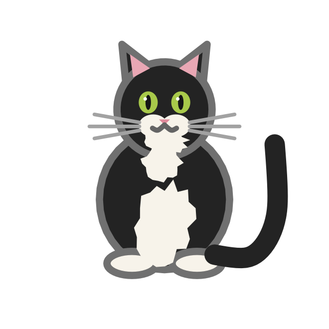
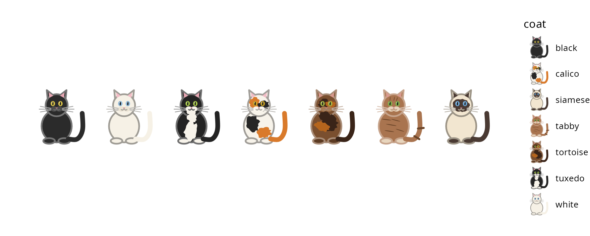
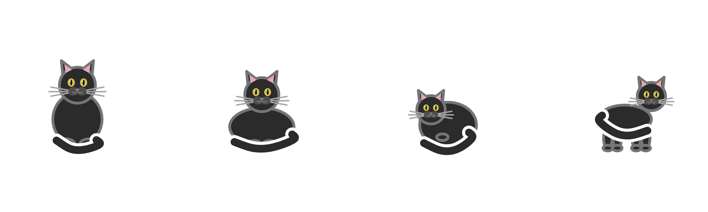
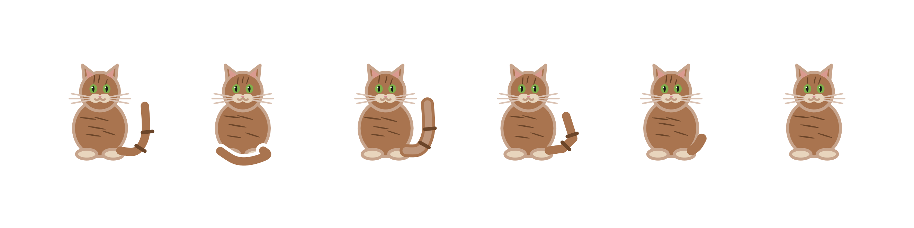
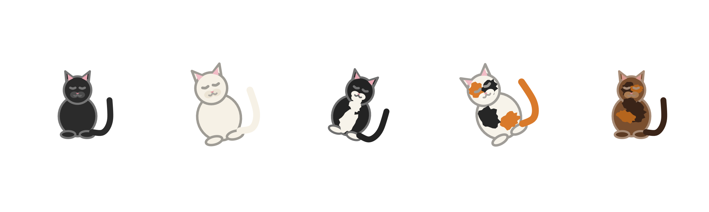
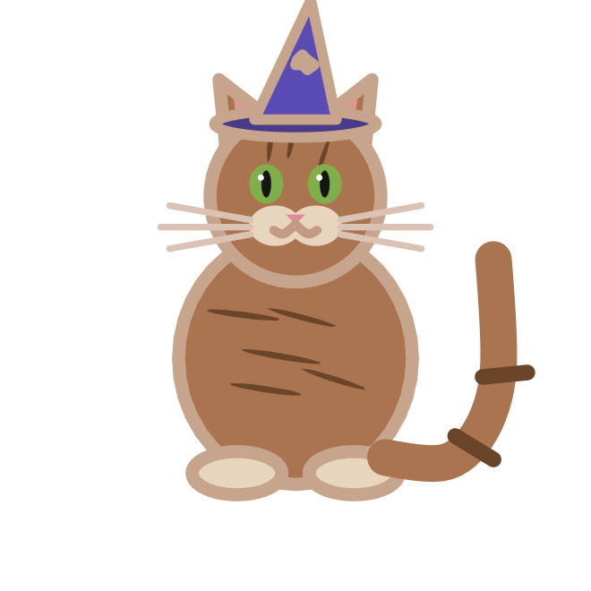
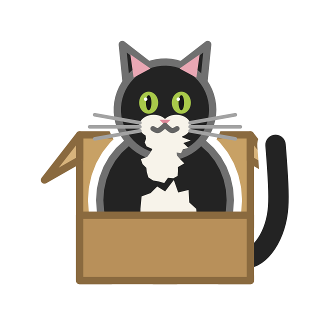
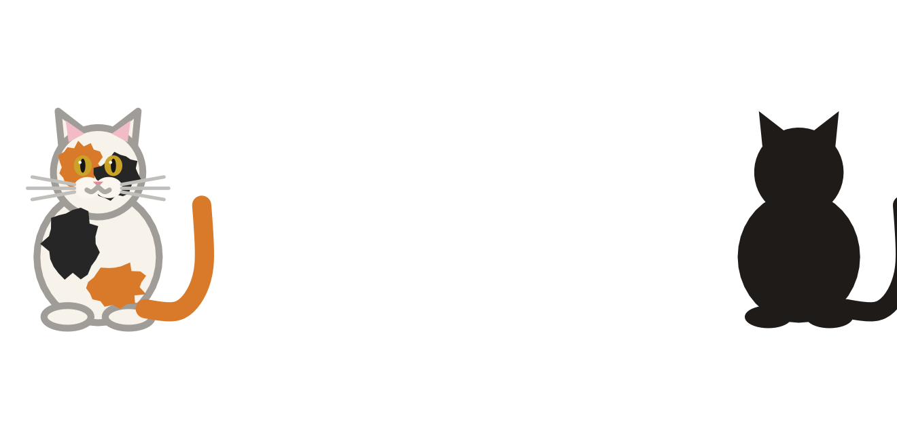
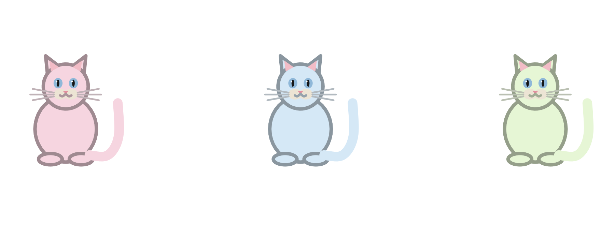

## Description

`geom_cat()` draws a cat at each observation. Cats come in seven coats:
`"black"`, `"white"`, `"tuxedo"`, `"calico"`, `"tortoise"`, `"tabby"` and
`"siamese"` (see [`cat_coats()`](cat-coats.qmd)), four poses (see
[`cat_poses()`](cat-poses.qmd)) and six tails (see
[`cat_tails()`](cat-tails.qmd)).

Each cat is drawn in a square viewport whose height is the `size`
aesthetic, in millimetres, so cats keep their proportions whatever the
shape of the panel.

## Usage

```r
geom_cat(
  mapping = NULL,
  data = NULL,
  stat = "identity",
  position = "identity",
  ...,
  eyes = c("open", "closed"),
  whiskers = TRUE,
  seed = 1,
  accessory = "none",
  mood = "none",
  silhouette = FALSE,
  na.rm = FALSE,
  show.legend = NA,
  inherit.aes = TRUE
)
```

## Arguments

| Argument | Description |
|:--|:--|
| `mapping` | Set of aesthetic mappings created by `aes()`. |
| `data` | The data to display in this layer. |
| `stat` | The statistical transformation. The default, `"identity"`, leaves the data unchanged. |
| `position` | A position adjustment. |
| `...` | Other arguments passed to `layer()`. These are often aesthetics set to a fixed value, such as `coat = "calico"` or `size = 12`. |
| `eyes` | `"open"` (default) or `"closed"`. |
| `whiskers` | Should the cat have whiskers? Defaults to `TRUE`. |
| `seed` | Integer used to vary the markings of calico, tortoise and tabby cats. |
| `accessory` | One of [`cat_accessories()`](cat-accessories.qmd). Defaults to `"none"`. |
| `mood` | One of [`cat_moods()`](cat-moods.qmd). Defaults to `"none"`. |
| `silhouette` | If `TRUE`, draw the cat as one solid shape with no face, markings, whiskers or accessory. |
| `na.rm` | If `FALSE` (default), missing values are removed with a warning. If `TRUE`, silently. |
| `show.legend` | Logical. Should this layer be included in the legends? |
| `inherit.aes` | If `FALSE`, overrides the default aesthetics rather than combining with them. |

## Aesthetics

`geom_cat()` understands the following aesthetics (required aesthetics are
in bold):

| Aesthetic | Default | Description |
|:--|:--|:--|
| **`x`** | — | Horizontal position. |
| **`y`** | — | Vertical position. |
| `coat` | `"black"` | One of [`cat_coats()`](cat-coats.qmd). Values are used as-is. |
| `pose` | `"sitting"` | One of [`cat_poses()`](cat-poses.qmd). Values are used as-is. |
| `tail` | `"up"` | One of [`cat_tails()`](cat-tails.qmd). Values are used as-is. |
| `size` | `8` | Height of the cat in mm. |
| `colour` | `NA` | Outline colour. `NA` picks a rim that contrasts with the fur. |
| `fill` | `NA` | Overrides the base fur colour. Coat markings are kept. |
| `alpha` | `NA` | Opacity of the whole cat. |
| `linewidth` | `1` | Multiplier for the outline width. |
| `angle` | `0` | Rotation in degrees, counter-clockwise. |

## Examples

### A fixed coat

```r
ggplot(mtcars, aes(wt, mpg)) +
  geom_cat(coat = "tuxedo", size = 10)
```

{width=200px fig-alt="A single tuxedo cat."}

### A mapped coat

`coat` is an aesthetic, so it can come from a column in your data. The
values are the coat names.

```r
cats <- data.frame(
  x = seq_along(cat_coats()),
  y = 1,
  coat = cat_coats()
)

ggplot(cats, aes(x, y, coat = coat)) +
  geom_cat(size = 22) +
  coord_equal() +
  theme_void()
```

{fig-alt="Seven cats with a legend of miniature cat keys."}

### Poses and tails

`pose` and `tail` are aesthetics too, so one layer can mix them.

```r
poses <- data.frame(x = seq_along(cat_poses()), y = 1, pose = cat_poses())

ggplot(poses, aes(x, y, pose = pose)) +
  geom_cat(size = 26, tail = "curl") +
  scale_pose_discrete(labels = toupper) +
  coord_equal() +
  theme_void()
```

{fig-alt="Four cats: sitting, in a loaf, curled up and standing."}

```r
tails <- data.frame(x = seq_along(cat_tails()), y = 1, tail = cat_tails())

ggplot(tails, aes(x, y, tail = tail)) +
  geom_cat(size = 26, coat = "tabby") +
  scale_tail_discrete(labels = toupper) +
  coord_equal() +
  theme_void()
```

{fig-alt="Six tabby cats with an upright tail, a curled tail, a plume, a kink, a bobtail and no tail."}

### Size, angle and expression

```r
ggplot(cats[1:5, ], aes(x, y, coat = coat)) +
  geom_cat(
    size = c(14, 18, 22, 26, 30),
    angle = c(0, 15, -20, 30, 0),
    eyes = "closed",
    whiskers = FALSE
  )
```

{fig-alt="Five rotated cats with closed eyes and no whiskers."}

### Accessories and moods

`accessory` and `mood` are layer parameters: one value applies to the whole
layer.

```r
ggplot(data.frame(x = 1, y = 1), aes(x, y)) +
  geom_cat(
    coat = "tabby",
    size = 40,
    accessory = "wizard_hat"
  )
```

{width=200px fig-alt="A tabby cat wearing a purple wizard hat."}

```r
ggplot(data.frame(x = 1, y = 1), aes(x, y)) +
  geom_cat(
    coat = "tuxedo",
    size = 40,
    mood = "box"
  )
```

{width=200px fig-alt="A tuxedo cat sitting in a cardboard box."}

### Silhouettes

```r
silhouettes <- data.frame(x = 1:2, y = 1)

ggplot(silhouettes, aes(x, y)) +
  geom_cat(data = silhouettes[1, , drop = FALSE], coat = "calico", size = 40) +
  geom_cat(
    data = silhouettes[2, , drop = FALSE],
    coat = "calico",
    size = 40,
    silhouette = TRUE
  )
```

{fig-alt="A calico cat beside the same cat drawn as a solid black silhouette."}

### Custom colours

`fill` replaces the base fur colour while keeping the coat's markings;
`colour` sets the outline; `alpha` fades the whole cat.

```r
pastels <- data.frame(
  x = 1:3,
  y = 1,
  fur = c("#f6d5e0", "#d5e8f6", "#e6f6d5")
)

ggplot(pastels, aes(x, y)) +
  geom_cat(coat = "white", fill = pastels$fur, size = 26, colour = "#6c6c6c")
```

{fig-alt="Three white cats with pink, blue and light green fur."}

## Details

- **`size` is millimetres, not points.** A cat of `size = 10` is 10 mm
  tall on the device, regardless of the panel's dimensions.
- **`linewidth` is a multiplier.** The base stroke scales with `size`, so
  outlines stay proportional when cats are large or small.
- **The sticker border is part of the drawing.** Each outer shape is drawn
  once in white, slightly wider, before the coloured cat. The die-cut
  border keeps the cat readable on light and dark backgrounds.
- **`colour = NA`** chooses a rim by luminance: dark fur gets a lighter
  rim, light fur a darker one.
- **Values are normalised** with `tolower()` and `trimws()`. Coats accept
  `"tortoiseshell"`, `"tortie"`, `"mackerel"`, `"point"` and
  `"colourpoint"`; poses and tails have their own aliases. Unknown values
  raise an error listing the supported ones.
- **`silhouette = TRUE`** drops the face, markings, whiskers and accessory
  and draws the body, head, ears, paws and tail as one solid shape. Pale
  coats fall back to ink; `fill` or `colour` overrides that.
- **The legend key is a cat.** `draw_key_cat()` draws a miniature cat whose
  size follows the `size` aesthetic.

## The ggproto object

`GeomCat` is exported so that other packages can build layers with it.

```r
GeomCat <- ggproto(
  "GeomCat",
  Geom,
  required_aes = c("x", "y"),
  non_missing_aes = c("size", "coat", "pose", "tail"),
  default_aes = aes(
    coat = "black",
    pose = "sitting",
    tail = "up",
    size = 8,
    colour = NA,
    fill = NA,
    alpha = NA,
    linewidth = 1,
    angle = 0
  ),
  extra_params = "na.rm",
  draw_key = draw_key_cat,
  draw_panel = function(self, data, panel_params, coord,
                        eyes = "open", whiskers = TRUE, seed = 1,
                        accessory = "none", mood = "none",
                        silhouette = FALSE) {
    coords <- coord$transform(data, panel_params)
    linewidth <- coords$linewidth
    linewidth[is.na(linewidth)] <- 1
    angle <- coords$angle
    angle[is.na(angle)] <- 0

    grobs <- lapply(seq_len(nrow(coords)), function(i) {
      cat_grob(
        x = unit(coords$x[i], "npc"),
        y = unit(coords$y[i], "npc"),
        width = unit(coords$size[i], "mm"),
        height = unit(coords$size[i], "mm"),
        coat = coords$coat[i],
        colour = coords$colour[i],
        fill = coords$fill[i],
        alpha = coords$alpha[i],
        angle = angle[i],
        eyes = eyes,
        whiskers = whiskers,
        seed = seed + i - 1L,
        stroke = coords$size[i] * 0.11 * linewidth[i],
        pose = coords$pose[i],
        tail = coords$tail[i],
        accessory = accessory,
        mood = mood,
        silhouette = silhouette
      )
    })
    gTree(children = do.call(gList, grobs))
  }
)
```

| Field | Purpose |
|:--|:--|
| `required_aes` | Checked before drawing; `x` and `y` must be supplied. |
| `non_missing_aes` | Rows with missing `size`, `coat`, `pose` or `tail` are dropped. |
| `default_aes` | Filled in when the user does not supply a value. Any name here is an aesthetic. |
| `extra_params` | Non-aesthetic parameters the layer accepts (`na.rm`). |
| `draw_key` | Draws the legend key. |
| `draw_panel` | Turns the layer data into grobs. Its formal arguments are the geom's parameters. |

::: {.callout-note}
## Why `draw_panel()` has no `...`

ggplot2 reads the arguments of `draw_panel()` to decide which layer
parameters are valid. Adding `...` would hide `eyes`, `whiskers`, `seed`,
`accessory`, `mood` and `silhouette` from that check.
:::

See the [extending guide](../extending.qmd) for the full walkthrough.
