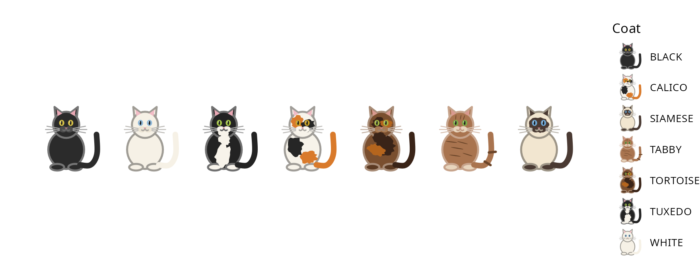

## Description

Coat names are also the values the aesthetic takes, so the default scale
passes them through unchanged. `scale_coat_discrete()` is that identity
scale. Use it to set a title, labels or limits for a mapped `coat`.

## Usage

```r
scale_coat_discrete(..., guide = "legend")
```

## Arguments

| Argument | Description |
|:--|:--|
| `...` | Arguments passed on to `scale_discrete_identity()`, such as `name`, `labels` or `limits`. |
| `guide` | A guide specification. Defaults to `"legend"`. |

## Value

A ggplot2 scale.

## Details

ggplot2 looks for a default scale named `scale_<aesthetic>_<type>` in the
environment of the `ggplot()` call. For a discrete aesthetic called
`coat`, that is `scale_coat_discrete()`. The package defines it, so mapping
`coat` works as soon as `library(geomfeliscatus)` is attached.

::: {.callout-note}
## Why identity?

`"calico"` is not a colour from a palette: it is a recipe for drawing a
calico cat. An identity scale is the right default because the values are
already meaningful. A palette-based `discrete_scale()` would turn
`"calico"` into an arbitrary hue and lose the meaning.
:::

## Examples

```r
cats <- data.frame(x = seq_along(cat_coats()), y = 1, coat = cat_coats())

ggplot(cats, aes(x, y, coat = coat)) +
  geom_cat(size = 20) +
  scale_coat_discrete(name = "Coat", labels = toupper)
```

{fig-alt="Five cats with a legend titled Coat and uppercase labels."}

The scale is also where you restrict which coats appear in the legend:

```r
ggplot(cats, aes(x, y, coat = coat)) +
  geom_cat(size = 20) +
  scale_coat_discrete(limits = c("black", "tuxedo"))
```
